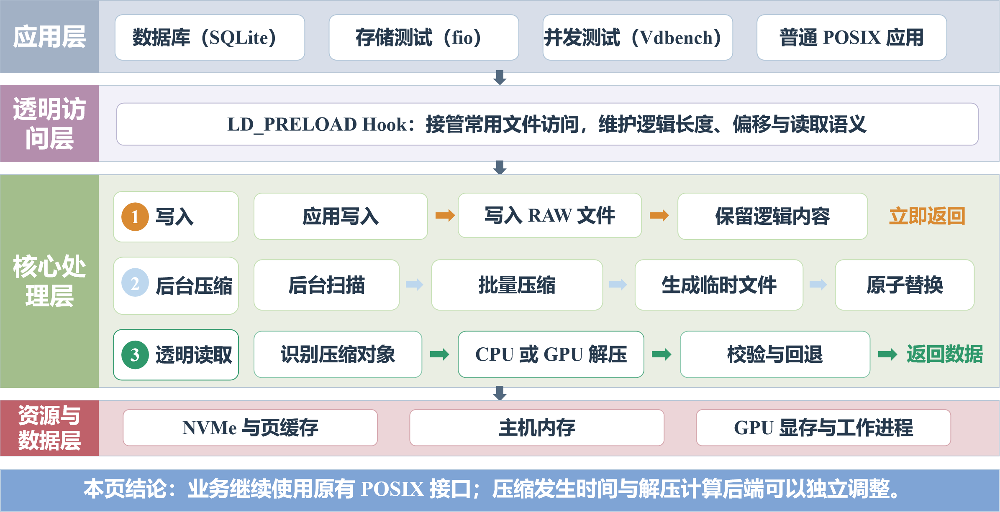

# GPUC：基于 GPU 的透明存储压缩卸载系统

## 题目信息

- **选题编号**：proj35
- **题目名称**：基于 GPU 的服务资源卸载技术探索
- **参赛高校**：西安交通大学
- **队伍 ID**：T2026106989910286
- **队伍名称**：404notfound

## 项目概述

GPUC 是一个面向透明存储压缩的用户态 GPU 卸载原型。在不修改应用源码、Linux
内核和现有 ext4/XFS 文件系统的前提下，系统通过 `LD_PRELOAD` Hook 接管指定动态
链接进程的常用 POSIX I/O：前台先写入完整 RAW 对象，后台 Daemon 批量压缩并原子
替换，读取时依据文件头选择 CPU 或 GPU 后端解压、校验并返回逻辑数据。

项目已经完成三类平台验证：

- NVIDIA Tesla V100：功能、性能、资源、Vdbench、PCM 和边界实验；
- NVIDIA GeForce RTX 4090：核心同吞吐卸载、SQLite、fio、Vdbench、一小时稳定性和
  故障恢复；
- 华为鲲鹏 920/AArch64 + 智铠 100/CoreX：CPU/GPU 原生构建、SGLZ 单元与端到端
  透明读写、数据搬运 A/B、16 GiB round-trip 和 1 GiB 大文件压力验证。

当前 COMPRESSED/INLINE 文件采用明确的只读归档模型，破坏性修改返回 `EROFS`。
完整设计与能力边界见[项目设计方案](docs/项目设计方案.md)。

## 决赛交付状态

截至 2026 年 8 月 16 日，项目设计方案、实验结果报告、实验复现指南、
国产平台部署指南和答辩 PPT 均已完成定稿。仓库同时保留 Markdown、Word、
PDF 与 PPTX 版本，便于在线查看、格式编辑和答辩展示。

作品演示视频作为独立交付物另行提交，不与本次文档和 PPT 定稿 commit
混合。

## 系统架构



系统主路径为：

1. **透明写入**：Hook 维护 Header、逻辑长度和偏移，应用写完 RAW 数据即可返回；
2. **后台压缩**：Daemon 批量压缩到临时文件，经 CRC32、`fsync` 后使用 `rename`
   原子替换；失败或收益不足时保留 RAW；
3. **透明读取**：Hook 解析块索引，选择 CPU/GPU 后端解压，校验成功后向应用返回
   原始逻辑内容；
4. **兼容回退**：GPU 不可见或初始化失败时使用 CPU SGLZ/liblz4 路径读取。

## 核心设计

### 自描述文件格式

| 组成 | 作用 |
|---|---|
| 56 B Header | 记录 magic、版本、状态、算法、原始逻辑大小和块参数 |
| 24 B × N 块索引 | 记录原始长度、压缩长度、物理偏移和 CRC32 |
| 4 KiB 对齐数据区 | 保存 RAW、SGLZ/LZ4 COMPRESSED 或小文件 INLINE 数据 |

默认逻辑块为 128 KiB。索引支持按逻辑范围直接定位，应用始终看到原始内容与逻辑
长度，而不是压缩后的物理布局。

### 双算法与多平台后端

- **SGLZ（Simple GPU Lempel–Ziv）**：本队自主实现的 CUDA LZ77 变体，将一个
  128 KiB block 划分为 32 个 4 KiB chunk；同时提供 CPU 兼容实现；
- **LZ4**：NVIDIA 平台可选 nvCOMP LZ4，CPU 回退使用 liblz4；
- **智铠 100/CoreX SGLZ**：在 `ivcore11` 上使用 CoreX Clang 编译，不依赖 NVIDIA nvCOMP；
- **统一格式与接口**：对象算法由持久化 Header 决定，同一 SGLZ 文件格式可在
  x86_64/NVIDIA、鲲鹏 920 CPU 和 CoreX GPU 路径间复用。

### 主要工程机制

| 机制 | 作用 |
|---|---|
| 前后台解耦 | 前台写 RAW，后台压缩，避免把压缩延迟直接加入业务写入 |
| 临时文件 + `fsync` + `rename` | 只在候选对象完整落盘后原子替换，异常时保留有效 RAW |
| 长期 GPU Worker | 复用 Context、Stream、Event、device buffer 和 Pinned buffer |
| Batch 与请求感知预读 | 摊薄 GPU 调度和传输固定成本，减少小随机读放大 |
| Pinned staging 与合并 H2D/D2H | 减少分散 DMA 与重复同步；NVIDIA、CoreX 均已完成 A/B |
| CPU/GPU 路由与回退 | 小请求可分流 CPU，GPU 不可用时保持对象可读取 |
| CRC32 与 SHA-256 | 分别验证块级内容与实验端到端逻辑数据一致性 |
| `userfaultfd` mmap | 对只读 `MAP_PRIVATE` 映射按缺页呈现逻辑内容，不支持时同步回退 |

## 已验证结果

正式统计、运行参数和适用边界见[实验结果报告](docs/实验结果报告.md)，原始数据索引见
[results/final/README.md](results/final/README.md)。

| 平台与证据 | 主要结果 | 结论范围 |
|---|---|---|
| RTX 4090，约 4 GiB/s 高可压缩 LZ4 解压 | GPU 相对 CPU 多保留 13.05% 合成业务吞吐；解压路径 CPU 时间降低 96.4% | 同机、同输入、同逻辑吞吐下，GPU 显著减轻主 CPU 竞争 |
| RTX 4090，SQLite 共机业务 | QPS +11.21%，p99 -81.66%；GPU QPS 仍比无解压 Baseline 低 5.14% | GPU 没有加速 SQLite 本身，而是降低并行解压干扰 |
| RTX 4090，fio/Vdbench | fio 多线程 60/60、Vdbench 50/50；error=0，逻辑 SHA 一致 | 验证端到端接口、并发退出和数据正确性 |
| RTX 4090，稳定与恢复 | 连续一小时读取 error=0、前后 SHA 一致；确定性软件故障 5/5 | 支持持续读取与软件故障恢复；不代表真实掉电/GPU reset |
| V100，同吞吐 PCM | 约 4 GiB/s 下 GPU/CPU 总主机 DRAM 为 4569.51/8745.46 MB/s | 特定高压缩率工作点中总带宽降低 47.75%，不等于内存容量下降 |
| 鲲鹏 920 CPU 路径 | AArch64 原生构建、smoke、2000 个格式 fuzz 和 16 MiB 端到端 SHA 全部通过 | 文件格式、Hook、Daemon 与 CPU 回退可跨 x86_64/AArch64 复用 |
| 鲲鹏 920 + 智铠 100 功能闭环 | SGLZ kernel、CoreX 测试、16 MiB GPU 端到端 SHA 全部通过 | 国产 CPU/GPU 上完成自研 SGLZ 透明压缩读取闭环 |
| 鲲鹏 920 + 智铠 100 传输优化 | 32-block batch 下压缩 845.929→985.727 MiB/s（1.165x），解压 688.415→718.622 MiB/s（1.044x） | 吞吐包含打包、H2D、Kernel、D2H 和散布，不包含磁盘 I/O |
| 鲲鹏 920 + 智铠 100 压力 | 累计 16 GiB/131072 blocks round-trip PASS；1 GiB 文件连续透明读取 3 次 SHA 一致 | 证明热路径和大文件正确性，不替代真实 NVMe、并发或整机能效测试 |

压缩文件的绝对 fio/Vdbench 吞吐仍低于普通文件路径，4 KiB 随机读、低压缩率和
压缩侧峰值也不是当前优势；这些负结果均保留在正式结果目录中。

## 快速开始

### NVIDIA x86_64 平台

```bash
bash scripts/check_env.sh
bash scripts/setup_dependencies.sh
make clean && make all
make test
bash scripts/demo.sh
```

LZ4 GPU 后端需要与 CUDA 版本匹配的 NVIDIA nvCOMP；默认 SGLZ 后端不依赖 nvCOMP。
具体依赖和推荐实验入口见[实验复现指南](docs/实验复现指南.md)。

### 鲲鹏 920 + 智铠 100/CoreX 平台

当前实测环境为 openEuler 22.03 LTS-SP1、2 路 64 核 Kunpeng-920、智铠 100
32 GiB 和 CoreX 4.4.0；`ixsmi` 将 GPU 识别为 Iluvatar MR-V100，设备架构为
`ivcore11`。

```bash
# 硬件、驱动、设备节点和编译器检查
bash check_hw.sh

# CPU 与 GPU 功能闭环；要求 GPU 必须通过
bash scripts/deploy_domestic_poc.sh --require-gpu

# 数据搬运 A/B、累计压力和 1 GiB 大文件端到端验证
bash tests/corex_performance_stress.sh
```

完整环境变量、CoreX 编译方式和验收标准见
[国产平台部署指南](docs/国产平台部署指南.md)。

### 手动体验写入—压缩—透明读取

```bash
mkdir -p /tmp/gpuc-demo

LD_PRELOAD="$PWD/bin/libgpuhook.so" GPUCOMPRESS_QUIET=1 \
  dd if=/dev/zero of=/tmp/gpuc-demo/data.bin bs=1M count=64 status=none

"$PWD/bin/gpu_compress_daemon" /tmp/gpuc-demo

LD_PRELOAD="$PWD/bin/libgpuhook.so" GPUCOMPRESS_QUIET=1 \
  dd if=/tmp/gpuc-demo/data.bin bs=1M status=none | sha256sum
```

## 目录导航

```text
.
├── .github/workflows/ci.yml       # CPU 构建与测试
├── include/                       # 文件格式和统一 CPU/GPU API
├── src/                           # Hook、Daemon、SGLZ、LZ4 与测试程序
├── tests/                         # 功能、性能、稳定性、资源和国产平台测试
│   ├── vdbench/                   # 顺序、随机与 70:30 混合读写配置
│   └── workload_tools/            # LevelDB 辅助负载
├── scripts/                       # 环境、部署、演示、文档与结果分析工具
├── docs/
│   ├── 项目设计方案.{md,docx,pdf}
│   ├── 实验结果报告.{md,docx,pdf}
│   ├── 实验复现指南.{md,docx,pdf}
│   ├── 国产平台部署指南.{md,docx,pdf}
│   ├── AI 工具使用说明.md
│   └── 架构图.png
├── results/
│   ├── README.md
│   └── final/                     # V100、RTX 4090、鲲鹏/智铠 100 正式证据
├── ppt/                           # 最终答辩 PPTX/PDF
├── video/                         # 演示视频（作为独立交付物）
├── Makefile
├── README.md
├── LICENSE
└── LICENSE-docs
```

## 文档与答辩材料

- [项目设计方案](docs/项目设计方案.md)：设计思路、实现、代码说明、问题解决、实验、
  第三方来源和团队分工；
- [实验结果报告](docs/实验结果报告.md)：V100、RTX 4090 与鲲鹏 920/智铠 100 的核心结果、
  统计口径和边界；
- [实验复现指南](docs/实验复现指南.md)：NVIDIA 平台的环境、构建和推荐实验入口；
- [国产平台部署指南](docs/国产平台部署指南.md)：鲲鹏 920/智铠 100 构建、功能验收、
  性能 A/B 和压力验证；
- [AI 工具使用说明](docs/AI%20工具使用说明.md)：AI 辅助范围与人工复核方式；
- [答辩 PPT](<ppt/GPUC 项目答辩 — 基于 GPU 的透明存储压缩卸载系统.pptx>)；
- 作品演示视频：独立交付，不纳入本次文档/PPT 定稿 commit。

## 当前能力边界

| 能力 | 当前状态 |
|---|---|
| 应用覆盖 | 加载 Hook 的动态链接 libc I/O；静态程序、直接 syscall 和应用自提交 io_uring 不透明覆盖 |
| 写入模型 | RAW 可写；COMPRESSED/INLINE 为只读归档对象，破坏性修改返回 `EROFS` |
| `mmap` | 支持只读 `MAP_PRIVATE`；不支持共享写、固定映射和完整跨 fork 语义 |
| `O_DIRECT` | 新版 4 KiB 对齐 COMPRESSED 格式支持；正式独占 NVMe 性能尚未完成 |
| NVIDIA 后端 | V100/RTX 4090 上 SGLZ 与 nvCOMP LZ4 已验证 |
| 国产后端 | 鲲鹏 920 CPU 与智铠 100/CoreX `ivcore11` SGLZ 已验证；不使用 NVIDIA nvCOMP LZ4 |
| 多 GPU | 一次使用单个可见设备，尚未实现跨 GPU 分片 |
| 生产接入层 | 当前是用户态机制原型，尚未实现 DM、ublk、Btrfs encoded I/O 或 ZFS 后端 |

## 第三方、AI 与许可证

- 源代码采用 [Apache License 2.0](LICENSE)，技术文档和答辩材料采用
  [CC BY-SA 4.0](LICENSE-docs)；
- CUDA、CoreX、nvCOMP、liblz4、fio、Vdbench、SQLite、Intel PCM 等第三方组件及
  许可证边界见[项目设计方案](docs/项目设计方案.md)；
- 核心系统由参赛队独立实现，第三方库作为运行时或测试工具使用；
- AI 辅助代码审阅、测试脚本和文档整理，具体范围见
  [AI 工具使用说明](docs/AI%20工具使用说明.md)；
- NVIDIA nvCOMP 官方项目：[NVIDIA/nvcomp](https://github.com/NVIDIA/nvcomp)。
