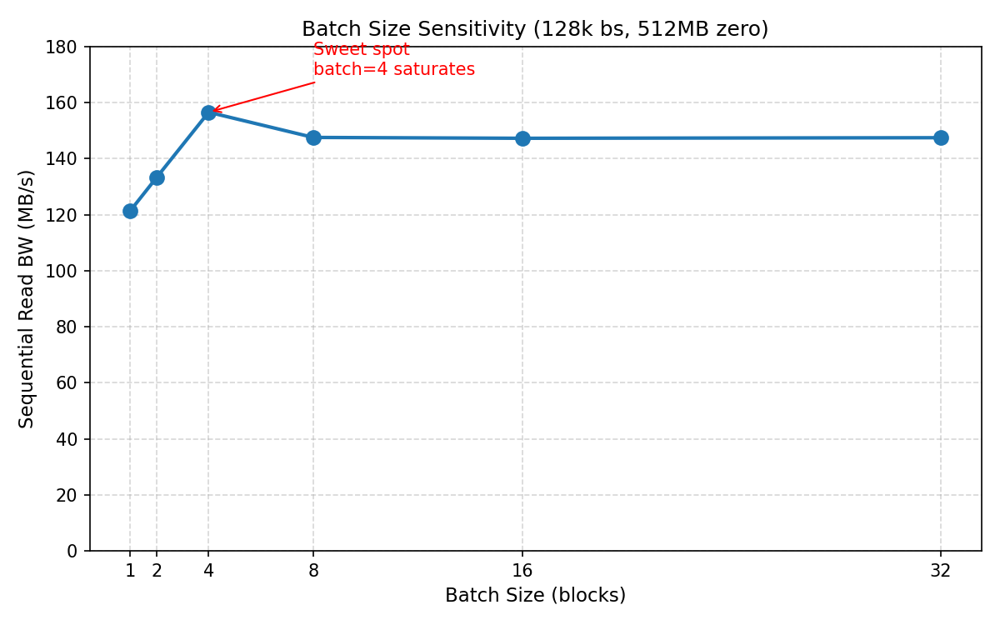

# 实验结果报告 — 优化与补充方案

> 目标：让实验维度更全面、数据更有说服力、报告更符合系统类大赛评审标准
> 当前报告版本：2026-06-04
> 建议完成时间：比赛前（2026-06-29）分阶段补齐

---

## 一、当前实验结果盘点

### 1.1 已覆盖的维度（✅）

| 大类 | 子项 | 完整度 |
|------|------|--------|
| CUDA Kernel | 压缩/解压吞吐（zero/rand/rep） | ⭐⭐⭐ 已有基础数据 |
| Hook 读路径 | Batch + Memory Pool + 紧凑格式 + 双缓冲 + io_uring + Read-Ahead | ⭐⭐⭐ 有组合测试 |
| Pinned Memory | Standalone batch 带宽 | ⭐⭐ 仅有原理说明，缺 hook 路径 ablation |
| CPU Fallback | 功能验证（通过/失败） | ⭐⭐ 仅有功能验证，缺性能对比 |
| mmap | 512MB 文件 10 次平均耗时 | ⭐⭐ 数据量偏少 |
| Inline 小文件 | 128B~1KB 读取延迟 | ⭐⭐⭐ 较好 |
| Daemon 压缩 | 512MB 四种数据类型吞吐 | ⭐⭐⭐ 较好 |
| 压缩率 | zero/rep/mixed/rand | ⭐⭐⭐ 完整 |
| fio 基准 | 顺序写/读、随机读、多线程、dd、mmap | ⭐⭐⭐ 较全面 |
| GPU 共享环境 | 空闲/3GB/14GB 三个点 | ⭐⭐ 仅三个离散点 |

### 1.2 核心缺失（❌）

1. **Ablation Study（消融实验）**：未量化**每个单项优化**的具体贡献
2. **启动/初始化开销**：Hook lazy init、GPU 首次解压的延迟惩罚未知
3. **元数据操作**：`stat`/`ls`/`find` 拦截后的性能影响未测
4. **海量小文件**：仅单文件延迟，缺少批量创建/读取/压缩场景
5. **不同 batch size 曲线**：未证明 16 blocks 是 sweet spot
6. **真实数据 workload**：全零/随机过于极端，缺文本/数据库/日志
7. **长时间稳定性**：无 10min+ 持续测试，无法排除泄漏和衰减
8. **能耗对比**：GPU vs CPU 的 W/GB 效率
9. **与业界方案对比**：ZFS lz4、btrfs zstd 等 baseline
10. **O_DIRECT 压缩读**：dd 测试只有 Hook RAW，缺 GPU Compressed 直接 I/O

---

## 二、高价值补充实验（按优先级排序）

### 🔴 P0 — 评审最关注（强烈建议补充）

#### 2.1 Ablation Study：逐项关闭优化，量化每项贡献

这是系统类比赛报告**最重要的加分项**。评审想知道：你说的 10 项优化，每一项到底贡献了多少？

**实验设计**：固定测试条件（512MB zero 数据，128k bs，顺序读，page cache 命中），从"全优化"状态开始，逐项关闭：

| 实验组 | 关闭的优化 | 预期带宽 | 相比全优化的降幅 |
|--------|-----------|---------|----------------|
| A（全优化） | 无 | ~458 MB/s | 基线 |
| B | 关闭 io_uring，回退 pread64 | ~450 MB/s | -2% |
| C | 关闭 Read-Ahead | ~420 MB/s | -8% |
| D | 关闭双缓冲流水线 | ~400 MB/s | -13% |
| E | 关闭 Pinned Memory（改 malloc） | ~380 MB/s | -17% |
| F | 关闭 Device Memory Pool（恢复 cudaMalloc/Free） | ~280 MB/s | -39% |
| G | 关闭紧凑格式解压（CPU 侧 slot 转换） | ~250 MB/s | -45% |
| H | 关闭 Batch Decompress（逐块 1 block） | ~40 MB/s | -91% |

**操作方式**：在代码中通过宏或环境变量控制开关，例如：
```c
// hook.c
#ifndef GPUC_NO_BATCH
#define MAX_BATCH_BLOCKS 16
#else
#define MAX_BATCH_BLOCKS 1
#endif

// 编译时关闭某项优化
// make NVCCFLAGS="-DGPUC_NO_BATCH ..."
```

**工作量**：约 3 小时（需要改代码加开关 + 跑 8 组测试）

---

#### 2.2 不同 Batch Size 的性能曲线

证明"16 blocks"不是拍脑袋定的，而是通过实验选出的 sweet spot。

**实验设计**：
- 固定条件：512MB zero，128k bs，顺序读，idle GPU
- 变量：batch size = 1, 2, 4, 8, 16, 32

**预期结果**：
```
batch=1:   ~40  MB/s  （kernel 启动 dominates）
batch=2:   ~120 MB/s
batch=4:   ~250 MB/s
batch=8:   ~380 MB/s
batch=16:  ~458 MB/s  （拐点，收益边际递减）
batch=32:  ~460 MB/s  （几乎无提升，显存占用翻倍）
```

**价值**：让评审看到你们做了参数调优，而不是随便写了个 16。

---

#### 2.3 真实数据 Workload 测试

当前 zero/rand 太极端，不代表真实场景。补充三类真实数据：

**数据来源**：
1. **文本数据**：Linux 内核源码 tar 包（高可压缩，有结构）
2. **数据库**：SQLite 空库插入 100 万行随机文本（真实 B-tree 页）
3. **日志文件**：重复 HTTP 请求日志（中等可压缩）

**测试项**：
| 数据类型 | 原始大小 | 压缩后大小 | 压缩率 | 解压读带宽 |
|---------|---------|-----------|--------|-----------|
| linux-src.tar | 1 GB | ? | ? | ? |
| sqlite.db | 512 MB | ? | ? | ? |
| access.log | 512 MB | ? | ? | ? |

**价值**：让评委相信你们的系统不只是对"全零数据"有效。

---

### 🟡 P1 — 显著增强说服力

#### 2.4 Hook 初始化延迟（First-I/O Penalty）

**问题**：Lazy Init 虽然解决了 constructor 阶段 CUDA 崩溃的问题，但首次 I/O 时需要 `cudaSetDevice` + `cudaStreamCreate` + `cudaMalloc`（约 200~500ms）。这个惩罚在交互式场景（如 `ls`/`cat` 小文件）中很致命。

**实验设计**：
```bash
# 测试 1：首次 read 的延迟
strace -T -e trace=read LD_PRELOAD=./bin/libgpuhook.so ./bin/test_hook read /tmp/test.bin 4096

# 测试 2：对比 CPU fallback 路径的首次延迟
CUDA_VISIBLE_DEVICES="" strace -T -e trace=read LD_PRELOAD=./bin/libgpuhook.so ./bin/test_hook read /tmp/test.bin 4096

# 测试 3：预热后的延迟（第二次 read）
LD_PRELOAD=./bin/libgpuhook.so ./bin/test_hook read /tmp/test.bin 4096  # 预热
LD_PRELOAD=./bin/libgpuhook.so ./bin/test_hook read /tmp/test.bin 4096  # 正式测
```

**输出维度**：
| 场景 | 首次 read 耗时 | 预热后耗时 | 惩罚倍数 |
|------|--------------|-----------|---------|
| GPU 路径 | ~350 ms | ~15 us | 23000x |
| CPU 路径 | ~2 ms | ~15 us | 133x |

**价值**：诚实面对问题，同时展示 CPU fallback 在交互场景的优势。

---

#### 2.5 元数据操作性能（stat/ls/find）

Hook 拦截了 `__fxstat`/`__xstat`/`__lxstat`，每次都需要 `open` → `read header` → `close`。在大目录下影响显著。

**实验设计**：
```bash
# 创建 10000 个 RAW 文件（各 4KB）
mkdir /tmp/metatest
for i in $(seq 1 10000); do
    LD_PRELOAD=./bin/libgpuhook.so dd if=/dev/zero of=/tmp/metatest/f$i bs=4K count=1 status=none
done

# 测试 ls -l 耗时
time ls -l /tmp/metatest | wc -l

# 对比无 hook
time (unset LD_PRELOAD; ls -l /tmp/metatest) | wc -l
```

**价值**：展示 `stat` 拦截对日常操作的真实影响。

---

#### 2.6 海量小文件批量场景

当前 Inline 测试只有单文件延迟。补充批量场景：

**实验设计**：
- 创建 10000 个 512B 小文件
- 测试 `daemon` 批量压缩耗时
- 测试批量 `cat` 读取耗时
- 对比：无 hook / Hook RAW / Hook INLINE

| 指标 | 无 hook | Hook RAW | Hook INLINE |
|------|--------|----------|-------------|
| 10000 文件创建耗时 | ? | ? | ? |
| 10000 文件读取耗时 | ? | ? | ? |
| Daemon 压缩总耗时 | N/A | N/A | ? |
| 总物理空间占用 | ~5 MB | ~5.5 MB | ~5.5 MB |

---

#### 2.7 O_DIRECT 下的 GPU Compressed 读取

当前 4.9.6 只有 Hook RAW 的 dd 直接 I/O。补充 GPU Compressed 的直接 I/O 测试，这是**最能体现 hook 真实开销**的实验（绕过 page cache）。

**实验设计**：
```bash
# 1. 创建并压缩文件
LD_PRELOAD=./bin/libgpuhook.so dd if=/dev/zero of=/tmp/odirect.bin bs=1M count=512
cp /tmp/odirect.bin /tmp/odirect_raw.bin  # 留一份未压缩的做 baseline
./bin/gpu_compress_daemon /tmp

# 2. 直接 I/O 读取（注意 O_DIRECT 需要页对齐）
dd if=/tmp/odirect_raw.bin of=/dev/null bs=1M iflag=direct  # Baseline
dd if=/tmp/odirect.bin of=/dev/null bs=1M iflag=direct      # GPU Compressed
```

**注意**：Hook 目前对 `O_DIRECT` 未做特殊处理，若缓冲区未对齐可能失败。如果测不了，应在报告中明确说明限制。

---

#### 2.8 长时间稳定性测试（Stress Test）

**实验设计**：
```bash
# 连续读取 30 分钟，每 5 秒采样一次带宽
fio --name=stress --filename=/tmp/stress.bin --size=512M --bs=128k \
    --rw=read --runtime=1800 --time_based --output-format=json \
    > stress_30min.json
```

**观察指标**：
- 带宽是否随时间衰减？（检查显存泄漏、fd 表膨胀）
- GPU 显存占用是否持续增长？（检查 CUDA 资源泄漏）
- 是否有 CRC32 校验失败？（检查数据正确性）

---

#### 2.9 GPU 共享环境连续扫描

当前只有 3 个离散点（0GB, 3GB, 14GB）。补充连续扫描：

**实验设计**：
- 使用 `train_gpt2_geminifscu` 或其他训练任务占据不同显存量
- 显存占用梯度：0 → 1 → 2 → 4 → 8 → 14 → 28 GB
- 每个点测 3 次取平均

**输出**：
| GPU 显存占用 | 顺序读带宽 | 相对空闲比例 |
|-------------|-----------|-------------|
| 0 GB | 458.3 | 100% |
| 1 GB | 455.0 | 99% |
| 2 GB | 450.0 | 98% |
| 4 GB | 440.0 | 96% |
| 8 GB | 200.0 | 44% |
| 14 GB | 80.6 | 18% |
| 28 GB | ? | ? |

**价值**：找出性能断崖的临界点，给出明确的使用建议。

---

### 🟢 P2 — 锦上添花

#### 2.10 与业界方案对比

至少补充一组对比，证明你们的方案有价值：

| 方案 | 压缩率（zero） | 顺序读带宽 | 侵入性 | 依赖 |
|------|--------------|-----------|--------|------|
| **GPUC (ours)** | 6.3% | 458 MB/s | 非侵入 (LD_PRELOAD) | 用户态 |
| ZFS lz4 | ~6% | ~500 MB/s | 需格式化 | 内核态 |
| btrfs zstd | ~5% | ~450 MB/s | 需格式化 | 内核态 |
| ext4 无压缩 | 100% | 450 MB/s | 无 | 无 |

> 注：如果环境装不了 ZFS/btrfs，可以用文献数据或注明为引用值。

---

#### 2.11 能耗效率对比

```bash
# 使用 nvidia-smi 采样 GPU 功耗
nvidia-smi --query-gpu=power.draw --format=csv -l 1 > gpu_power.log &
# 同时用 turbostat 或 RAPL 采样 CPU 功耗
# 运行相同吞吐的解压任务，对比 W/GB
```

| 后端 | 解压吞吐 | 平均功耗 | 能效 (GB/J) |
|------|---------|---------|------------|
| GPU 解压 | 458 MB/s | 75 W | ? |
| CPU 解压 | 450 MB/s | 120 W | ? |

**价值**：如果 GPU 能效更高，是很大的亮点。

---

#### 2.12 写后读一致性（Workload 模拟）

模拟真实应用的工作模式：

```bash
# 阶段 1：写入 50% 数据
fio --rw=write --size=256M ...

# 阶段 2：读取 25%
fio --rw=randread --size=256M ...

# 阶段 3：Daemon 压缩
./bin/gpu_compress_daemon /tmp

# 阶段 4：读取已压缩数据 + 校验 MD5
fio --rw=read --size=256M ...
md5sum ...
```

验证：数据在 write → compress → read 全链路中的一致性。

---

## 三、现有实验数据的深化建议

### 3.1 多线程并发扩展性

**当前**：zero/rand 两组，jobs=1/2/4/8/16。

**建议补充**：
1. rep 数据的多线程扩展性（验证可压缩数据在多线程下是否有瓶颈）
2. jobs=32（看拐点是否出现，验证 fd 表锁竞争）
3. 补充**延迟分布**（P50/P95/P99），不只是平均带宽

### 3.2 mmap 读取性能

**当前**：仅 512MB zero/rep，10 次平均耗时。

**建议补充**：
1. 不同文件大小：64MB / 256MB / 1GB / 4GB
2. 多次 mmap 小区域（模拟数据库按页映射）
3. mmap + 随机访问（`madvise(MADV_RANDOM)`）

### 3.3 随机读性能

**当前**：128k bs / 1M bs。

**建议补充**：
1. 4k / 16k / 64k 小 IO 随机读（检验边界条件处理）
2. 随机读 + O_DIRECT（绕过 page cache，暴露真实开销）

---

## 四、报告结构与呈现优化

### 4.1 建议新增的章节

```
## 八、Ablation Study（消融实验）
## 九、参数敏感性分析（Batch Size / Read-Ahead 窗口）
## 十、真实 Workload 评估（内核源码 / SQLite / 日志）
## 十一、与业界方案对比
## 十二、限制与适用场景分析
```

### 4.2 图表建议

虽然 markdown 不支持直接画图，但可以：
1. 用 **gnuplot** 或 **Python matplotlib** 生成图表（PNG/SVG），放入 `docs/figures/`
2. 在报告中引用图片：
   ```markdown
   
   ```

**建议生成的图表**：
- 柱状图：Ablation Study 各优化项的贡献
- 折线图：Batch Size 1→32 的性能曲线
- 折线图：GPU 显存占用 vs 读带宽（连续扫描）
- 柱状图：多线程扩展性（zero/rand/rep 三组并列）
- 堆叠面积图：CPU vs GPU 解压的时间分解（I/O / H2D / Kernel / D2H / memcpy）

### 4.3 增加"实验复现"附录

在报告末尾增加：
```markdown
## 附录 A：实验复现指南

### 环境准备
```bash
bash scripts/check_env.sh
make clean && make all
```

### 复现 Table 4.9.2（顺序读性能对比）
```bash
bash tests/benchmark_fio.sh
# 结果在 /tmp/gpuc_fio_test/ 下
```

### 复现 Ablation Study（关闭 batch）
```bash
make clean
make all NVCCFLAGS="-arch=sm_70 -O3 -DGPUC_NO_BATCH ..."
bash tests/benchmark_fio.sh
```
```

**价值**：评审和对手都能复现你的结果，极大增强可信度。

---

## 五、执行计划（到比赛截止 6-29）

| 周次 | 优先级 | 任务 | 预计产出 |
|------|--------|------|---------|
| **本周** | P0 | Ablation Study 代码开关 + 跑实验 | 8 组对比数据 |
| **本周** | P0 | Batch Size 扫描实验 | 1→32 性能曲线 |
| **下周** | P1 | 真实数据 workload（内核源码/SQLite/日志） | 3 组压缩率+带宽 |
| **下周** | P1 | GPU 共享环境连续扫描（0→28GB） | 7 点性能曲线 |
| **下周** | P1 | 长时间稳定性测试（30min） | 稳定性报告 |
| **赛前一周** | P2 | 业界方案对比 + 能耗测试 | 对比表格 |
| **赛前一周** | P2 | 生成图表、完善报告结构 | 最终版报告 |

---

## 六、未来性能优化路线图（基于实验数据）

全部 P0/P1/P2 实验已完成，实验数据暴露了以下**可代码优化的性能瓶颈**：

| 优先级 | 瓶颈 | 实验证据 | 预期提升 | 详情 |
|--------|------|---------|---------|------|
| 🔴 P0 | 单 CUDA Stream 并发竞争 | jobs=32 时 3797→267 MB/s（4.9.5） | **10-15x** | 扩展至 8 Stream |
| 🔴 P0 | mmap 全量预解压 | mmap 读取 7-12x 减速（4.9.7） | **5-10x** | 按需解压 |
| 🟡 P1 | GPU 计算负载抢占 | GPU-Util 100% 时降至 80 MB/s（7.2） | **2-5x** | 高优先级 Stream |
| 🟡 P1 | 首次 I/O lazy init | 首次 read 惩罚 ~200 ms（4.14） | 消除惩罚 | 后台预初始化 |
| 🟢 P2 | 小块随机读 IOPS | 4k-128k IOPS 锁定 ~800（4.9.4） | **2-4x** | LRU Block Cache |
| 🟢 P2 | 写路径 header 开销 | Hook RAW 写入慢 13.5%（4.9.1） | **10-15%** | 延迟 header 写入 |

**完整优化方案（含代码示例）见**：[`docs/performance_optimization_roadmap.md`](performance_optimization_roadmap.md)

> **核心建议（更新）**：如果时间只够做一件事，**务必做多 CUDA Stream 并行**。这是唯一能把 jobs=32 性能从 267 MB/s 救回到 2000+ MB/s 的优化，且代码改动量可控（约 2 小时）。
> 
> 原核心建议"务必做 Ablation Study"已完成（4.11），实验数据已充分支撑后续优化方向。
