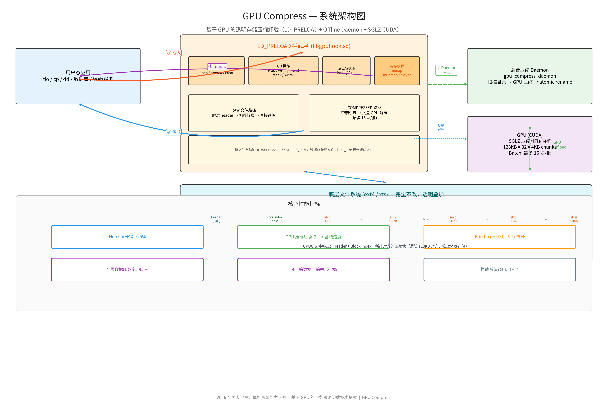

# 基于 GPU 的服务资源卸载技术探索——项目设计方案

> 选题编号：proj35  
> 参赛队伍：西安交通大学 404notfound  
> 最终版本：2026-08-09

## 1. 研发背景与目标

### 1.1 问题背景

全闪存和 NVMe 服务器的介质性能不断提升，I/O 数据处理本身逐渐成为 CPU 开销的
重要来源。若存储路径还需要执行压缩、校验和、编码等计算，主 CPU 将与上层数据库、
应用和中间件直接竞争资源。传统 CPU 压缩实现部署成熟，但无法回答“是否可以利用
服务器中的 GPU 通用算力为主 CPU 释放资源”。

### 1.2 项目目标

GPUC 围绕以下目标设计：

1. 不修改应用源码、操作系统内核和现有文件系统；
2. 对指定动态链接进程透明呈现压缩对象的原始内容和逻辑大小；
3. 将高吞吐解压计算卸载到 GPU，降低主机 CPU 竞争；
4. 前台写路径不进行同步压缩，由后台 Daemon 错峰处理；
5. 保证原子替换、校验、故障恢复和逻辑数据一致性；
6. 用 fio、Vdbench、SQLite、PCM、故障注入和长期稳定性形成可复核证据；
7. 如实说明当前用户态原型与 DM/Btrfs/ZFS 生产方案之间的边界。

### 1.3 需求分析与验收条件

项目需求不仅包括“调用 GPU 完成解压”，还包括应用语义、故障处理、资源测量和
实验复现。各项需求与验收方式如下：

| 需求类别 | 具体要求 | 设计响应 | 验收方式 |
|---|---|---|---|
| 应用接入 | 现有动态链接程序无需修改源码 | 通过 `LD_PRELOAD` 拦截常用 libc I/O | cp/dd/fio/Vdbench/SQLite 运行验证 |
| 数据格式 | 同时保存逻辑大小、算法和块位置 | 固定 Header、Block Entry 与算法 ID | Header 审计、逻辑长度与 SHA 校验 |
| 计算卸载 | 大批量解压进入 GPU | 长期 Worker、Batch、Pinned Buffer、CUDA Stream | CPU/GPU 同吞吐 A/B |
| 兼容回退 | GPU 不可见时仍可读取 | CPU SGLZ/liblz4 后端与算法路由 | GPU 隐藏故障测试 |
| 数据正确性 | 任意读取范围返回原始逻辑内容 | CRC32、SHA-256、offset 与长度校验 | 单元、集成、fio、Vdbench 校验 |
| 并发安全 | 多线程读和关闭过程稳定 | fd 引用计数、I/O 锁、TLS Buffer、锁外析构 | 1/4 线程退出回归、共享 fd 测试 |
| 持续运行 | 长时间读取无错误和数据变化 | 持久资源、稳定状态机和错误传播 | RTX 4090 一小时测试 |
| mmap 兼容 | 只读映射按需呈现逻辑内容 | userfaultfd missing-page 与同步回退 | 多尺寸、单/8线程 mismatch 验证 |
| 可观测性 | 能解释 CPU、DRAM 和 GPU 变化 | 分阶段 profile、pidstat/sar/perf/PCM 日志 | 原始日志、runs.csv、summary.csv |
| 可复现性 | 新机器可以检查、构建和重跑 | 环境脚本、Makefile 自动架构、参数化 runner | 干净路径部署验证 |

### 1.4 典型使用场景

GPUC 面向读取占主导、写后形成稳定对象的工作负载：

- **归档与扫描服务**：日志、文本、模型中间数据写入后转为只读对象，后续进行批量
  顺序扫描；
- **CPU 资源竞争场景**：压缩读取与数据库、检索或计算服务共机运行，目标是减少
  解压对主 CPU 的占用；
- **GPU 富余服务器**：GPU 已随服务器部署，业务阶段存在可利用的 CUDA 计算资源；
- **存储机制预研**：在进入 DM/Btrfs/ZFS 内核路径前，验证压缩格式、GPU 后端、
  Batch、传输和恢复策略。

当前实现将压缩对象定义为只读归档文件，适合“写入—封存—重复读取”的生命周期。

## 2. 方案定位与技术路线

### 2.1 赛题涉及的三类技术路线

存储压缩可以放在块层、文件系统层，也可以先在用户态验证关键机制。三种路线的
位置、能力和工程重点不同：

| 路线 | 典型形态 | 主要优势 | 工程关注点 |
|---|---|---|---|
| Device Mapper 块层压缩 | dm-vdo 或自定义 DM target | 位于文件系统下方，上层可继续使用 ext4、XFS 等不同文件系统，接入范围广 | 逻辑块映射、元数据一致性、崩溃恢复、队列并发和校验 |
| 文件系统层压缩 | Btrfs extent、OpenZFS record | 能感知文件、extent、record 和数据集策略，可按内容与访问模式选择压缩 | 与特定文件系统绑定；端到端性能同时受 CoW、元数据和缓存路径影响 |
| 用户态机制原型 | GPUC Hook + Daemon | 开发与验证周期短，可快速比较 CPU/GPU 后端、传输和调度策略 | 覆盖指定动态链接进程，当前压缩对象采用只读归档模型 |

Linux 内核的 [dm-vdo 文档](https://www.kernel.org/doc/html/latest/admin-guide/device-mapper/vdo.html)
给出了块层去重、压缩和精简配置的完整实例，并说明 Device Mapper target 可服务于
不同上层文件系统。Btrfs 官方文档说明其在文件 extent 层执行透明压缩，并按
128 KiB chunk 处理数据；OpenZFS 则按 dataset 和 record 管理压缩策略。文件系统
层能够利用更丰富的数据语义，而实际吞吐、延迟和 CPU 开销仍需在目标介质与目标
工作负载上通过 fio、Vdbench 实测。在小随机写、频繁元数据更新等场景中，CoW 与
元数据路径可能使 Btrfs/ZFS 的绝对性能低于 ext4/XFS，因此文件系统能力与绝对
I/O 性能需要同时比较。

参考：[Btrfs 压缩说明](https://btrfs.readthedocs.io/en/latest/btrfs-man5.html)、
[OpenZFS 压缩说明](https://openzfs.github.io/openzfs-docs/Basic%20Concepts/Data%20Storage/Compression.html)。

### 2.2 GPUC 当前技术路线

GPUC 当前形态为：

```text
动态链接应用
    ↓ LD_PRELOAD
GPUC Hook：I/O 拦截、格式识别、逻辑语义、透明读取
    ├─ 写路径：RAW → 离线 Daemon → GPU 压缩 → fsync + atomic rename
    └─ 读路径：索引 → Batch I/O → H2D → GPU 解压 → D2H → CRC32 → 返回
    ↓
现有 ext4 / XFS + 单个可见 NVIDIA CUDA 或天数智芯 CoreX GPU
```

该方案属于低侵入机制验证：启用范围由进程的 `LD_PRELOAD` 控制，取消环境变量即可
恢复原路径。它不覆盖静态链接程序、直接 syscall 或应用自行提交的 io_uring；
COMPRESSED/INLINE 对象采用只读归档模型，当前不是在线可写的块层或文件系统实现。

### 2.3 关键设计决策

| 设计决策 | 选择 | 原因与影响 |
|---|---|---|
| 接入位置 | 用户态 Hook | 快速覆盖多种应用并保留 ext4/XFS；便于独立验证 GPU 机制 |
| 压缩时机 | 后台离线压缩 | 前台写入延迟稳定，压缩可错峰执行，失败时保留 RAW |
| 压缩对象语义 | COMPRESSED/INLINE 只读 | 简化随机覆盖、索引更新和崩溃一致性，形成明确状态机 |
| 基本块大小 | 128 KiB | 匹配 Btrfs 常见压缩 chunk 和 GPU Batch 粒度，兼顾索引规模 |
| SGLZ 子粒度 | 4 KiB × 32 | 让一个逻辑块内部产生 GPU 并行度，并保留不可压缩 chunk 回退 |
| 算法后端 | SGLZ + nvCOMP LZ4 | 同时展示自研 GPU 算法和工程可用的标准压缩后端 |
| 小请求策略 | CPU/GPU 按粒度分流 | 单块请求优先降低 CUDA 固定开销，批量请求用于 GPU 卸载 |
| 数据替换 | 同目录临时文件 + `fsync` + `rename` | 原对象始终可恢复，替换过程具备原子可见性 |
| GPU 生命周期 | 进程内长期 Worker | 复用 Context、Stream、Event 和 Buffer，降低热路径初始化成本 |
| 观测口径 | Baseline/CPU/GPU 同机三路径 | 将算法、I/O、业务竞争和资源变化分开解释 |

### 2.4 从机制原型到存储路径的演进

GPUC 将压缩算法接口与 I/O 接入层分离。当前 Hook 调用的 CPU/GPU Batch API 可以
在后续阶段被 ublk、Device Mapper target 或文件系统 encoded I/O 复用：

```text
阶段一：LD_PRELOAD + Daemon
    验证格式、算法、Batch、传输、业务收益和故障策略
        ↓
阶段二：ublk / 用户态块设备
    扩展到文件系统无关的块接口，验证队列与写时更新
        ↓
阶段三：Device Mapper target
    将映射、元数据事务和恢复移入内核存储栈
        ↓
阶段四：Btrfs encoded I/O / OpenZFS record 接口
    利用文件、extent、record 和数据集语义选择压缩策略
```

演进过程中保持统一的算法 ID、块校验、CPU fallback 和实验指标，减少不同接入层
之间的重复实现。

## 3. 系统架构



系统分为四层：

- **应用层**：fio、Vdbench、SQLite、扫描服务和其他动态链接应用；
- **透明接入层**：`libgpuhook.so` / `libcpuhook.so`，完成 POSIX I/O 拦截、格式
  识别、逻辑大小和 offset 维护、mmap 缺页处理；
- **核心处理层**：离线压缩路径与在线透明读取路径；
- **资源与数据层**：GPUC 文件格式、ext4/XFS、CUDA GPU、校验与故障恢复机制。

### 3.1 进程与线程拓扑

系统运行时包含三类执行实体：

| 执行实体 | 生命周期 | 主要职责 |
|---|---|---|
| 应用线程 + Hook | 随应用进程创建和退出 | 拦截 I/O、维护 fd 元数据、提交读请求、返回逻辑数据 |
| 离线 Daemon | 独立进程，可按目录周期运行 | 扫描 RAW、构造压缩文件、同步并原子替换 |
| GPU Worker | Hook/后端首次使用时启动 | 聚合请求，复用 CUDA Context/Stream/Buffer，执行批量解压 |
| userfaultfd Handler | 每个受管 mmap 上下文创建 | 接收 missing fault、定位 GPUC block、填充映射页 |

Hook 与 Daemon 不共享可变内存，而是通过 GPUC 文件状态和原子文件替换协作。应用
进程内部的提交线程通过条件变量等待 Worker 完成，GPU 执行期间线程进入阻塞等待，
减少 busy-spin 对业务核心的影响。

### 3.2 控制流与数据流

| 操作 | 控制流 | 数据流 |
|---|---|---|
| 创建/写入 | Hook 判断路径和白名单，初始化 RAW Header | 用户数据写入 RAW payload，维护逻辑 offset |
| 关闭 | 更新 Header、逻辑长度和时间信息 | 不触发前台同步压缩 |
| 后台压缩 | Daemon 校验状态、选择算法并创建临时文件 | RAW → Batch 压缩 → Header/索引/payload → 原子替换 |
| 打开读取 | Hook 读取 Header，识别 RAW/COMPRESSED/INLINE | 加载或映射块索引，注册 fd 元数据 |
| `read/pread` | 计算逻辑范围、命中缓存或构造 Batch | 压缩块 → H2D → GPU → D2H → CRC → 用户缓冲区 |
| `fstat/lseek` | 使用受管 fd 元数据 | 向应用呈现 `orig_size` 与逻辑 offset |
| `mmap` | 建立 userfaultfd 上下文和 handler | 缺页时按 GPUC block 解压并 `UFFDIO_COPY` |

### 3.3 组件依赖关系

Hook 只依赖统一 C API，不直接暴露 nvCOMP 或 CUDA 类型；`gpu_compress_api.h` 将
SGLZ、LZ4、CPU 和 GPU 后端收敛为相同的 128 KiB 单块与 Batch 接口。Daemon 与
Hook 共用 `file_header.h`，确保状态、算法 ID、块大小和 CRC 定义一致。测试脚本
通过环境变量组合后端、块大小、线程、吞吐和结果目录，不在代码中固化实验机器。

## 4. 核心设计

### 4.1 GPUC 文件格式

GPUC 对象由文件头、块索引和数据区组成：

| 项目 | 设计 |
|---|---|
| Header | 56 B，记录 magic、版本、逻辑大小、块数、状态、算法和时间信息 |
| Block Entry | 新格式 24 B，记录原始长度、压缩长度、物理 offset、CRC32 和对齐跨度 |
| 逻辑块 | 固定 128 KiB |
| SGLZ chunk | 128 KiB 拆为 32 × 4 KiB，可在 GPU 上并行处理 |
| Direct I/O | Header、索引和 payload 按 4 KiB 对齐 |
| 状态 | RAW、COMPRESSED、BUSY、INLINE |

状态转换为 `RAW → 临时压缩文件 → COMPRESSED/INLINE`。低可压缩率文件不会强制
保留压缩结果，而是回退 RAW，避免无收益的空间和计算开销。

### 4.2 写入与离线压缩

Hook 写路径只维护 RAW Header、逻辑 offset 和原始数据，不在应用 `write()` 中执行
同步压缩。离线 Daemon 扫描指定归档目录，按 128 KiB 分块压缩并构造索引，完整
写入临时文件后执行 `fsync`，最后通过 `rename()` 原子替换。该设计避免前台写延迟，
也保证中途失败时原 RAW 对象仍然存在。

### 4.3 在线透明读取

读取 COMPRESSED 对象时，Hook 根据逻辑 offset 查询块索引，通过 `pread` 或内部
io_uring 批量获取压缩块；随后将输入整理到 Pinned staging buffer，以合并 H2D
传输提交给长期 GPU Worker。GPU 完成批量解压后合并 D2H 返回，Hook 校验 CRC32，
再把请求范围复制给应用。应用看到的是原始逻辑数据和逻辑文件大小。

### 4.4 mmap 路径

只读 `MAP_PRIVATE` 映射优先使用 userfaultfd missing-page 模式。缺页线程根据 fault
地址定位对应 128 KiB GPUC block，读取或解压后通过 `UFFDIO_COPY` 填充映射。
内核不支持时可回退同步填充；`MAP_SHARED`、`MAP_FIXED` 和在线写映射不在当前
支持范围。mmap 返回、首次 fault 和完整扫描成本分别统计，不把工作量后移描述为
工作量消失。

### 4.5 双压缩后端

- **SGLZ**：本队自主实现的 CUDA LZ77 变体，128 KiB block 内 32 个 4 KiB chunk
  独立处理，体现 GPU 通用计算能力；
- **nvCOMP LZ4**：通过公开 C API 集成的可选后端，用于获得更好的真实文本压缩率；
- **CPU 路径**：提供 CPU SGLZ 与 liblz4 实现，用于兼容、故障回退和公平对照。

文件头记录算法 ID，读取端按对象实际格式选择解码器，防止实验标签和真实算法不一致。

### 4.6 算法路由与回退

算法选择以文件头为准，而不是依赖读取进程的临时环境变量。路由过程如下：

1. RAW 对象直接读取原始 payload；
2. INLINE 对象直接从 Header 后返回小文件内容；
3. SGLZ COMPRESSED 对象进入 SGLZ CPU/GPU 后端；
4. LZ4 COMPRESSED 对象进入 liblz4 或 nvCOMP 后端；
5. GPU 初始化或执行失败时，根据对象算法切换到对应 CPU 解码器；
6. Header、索引、长度、offset 或 CRC 异常时向应用返回明确错误。

这种设计保证对象的解码算法由持久化元数据确定，也使 GPU 故障回退和跨机器读取
具有确定行为。

### 4.7 并发控制与资源生命周期

系统将锁分为三个层次：

- **fd 表锁**：仅保护全局 fd 到元数据对象的映射和引用计数；
- **每对象 I/O 锁**：保护共享 open file description 的 read-ahead、cache 和
  逻辑状态；
- **Worker 队列锁**：保护 GPU 请求队列和完成条件变量，不覆盖 CUDA 执行阶段。

大块内存、Pinned Buffer 和 CUDA 资源均在元数据锁外释放。不同 `open()` 产生的
fd 可以并行处理；共享同一 fd 的 `pread` 通过对象锁保证 cache 和 Stream 归属一致。
线程局部 staging buffer 按需扩容并在线程退出时回收。

### 4.8 POSIX 接口语义

| 接口 | RAW | COMPRESSED/INLINE |
|---|---|---|
| `open/openat` | 创建或识别受管对象 | 解析 Header、加载索引、注册只读元数据 |
| `read/pread/readv` | 访问 RAW payload | 按逻辑 offset 透明解压并返回原始数据 |
| `write/pwrite/writev` | 更新原始数据和逻辑长度 | 返回 `EROFS` |
| `fstat/stat` | 隐藏 Header，报告逻辑大小 | 报告 `orig_size` |
| `lseek` | 维护逻辑 offset | 以逻辑文件空间移动 offset |
| `mmap` | 普通文件映射 | 只读 `MAP_PRIVATE` 使用 userfaultfd 或同步回退 |
| `truncate/ftruncate` | 更新 RAW 逻辑长度 | 返回 `EROFS` |
| `dup/dup2/dup3` | 共享受管元数据引用 | 共享受管元数据引用 |
| `close` | 刷新状态并减少引用 | 最后引用在锁外释放缓存与 GPU 资源 |

### 4.9 可观测性设计

GPU LZ4 后端为每次 Batch 保存 queue、pack、H2D、kernel、D2H、unpack 和 total
阶段耗时，并记录输入、输出和压缩块数量。正式 runner 同时保存：

- 进程 CPU、user/system time、RSS、page fault 和 context switch；
- GPU 利用率、显存、板卡功耗与计算能力；
- fio/Vdbench 的吞吐、IOPS、平均延迟和尾延迟；
- PCM 的 IMC read/write/total bandwidth；
- 输入 SHA、Header 状态、算法 ID、逻辑大小和物理占用。

这些数据将“算法时间、PCIe 传输、存储读取、主机资源和业务影响”拆开分析。

## 5. 关键实现与代码说明

| 模块 | 主要文件 | 作用 |
|---|---|---|
| 文件格式 | `include/file_header.h` | Header、Block Entry、状态、算法 ID、CRC32 |
| 统一接口 | `include/gpu_compress_api.h` | CPU/GPU/SGLZ/LZ4 后端 API |
| 透明 Hook | `src/hook.c` | POSIX I/O、fd 元数据、Batch 读、mmap、逻辑语义 |
| GPU Daemon | `src/daemon.c` | 目录扫描、GPU 压缩、临时文件与原子替换 |
| CPU Daemon | `src/cpu_daemon.c` | CPU 对照和无 GPU 路径 |
| 自研 GPU 算法 | `src/gpu_compress.cu` | SGLZ CUDA 压缩与解压 |
| 自研 CPU 算法 | `src/cpu_compress.c` | SGLZ CPU 兼容实现 |
| LZ4 GPU 后端 | `src/gpu_lz4.cu` | nvCOMP LZ4、长期 Worker、持久资源与合并传输 |
| LZ4 CPU 后端 | `src/cpu_lz4.c` | liblz4 解码和小请求分流 |
| 自动测试 | `tests/` | 功能、性能、故障、长期、fio、Vdbench、PCM 等 |

### 5.1 Hook 内部组织

Hook 为受管文件维护 fd 元数据，包括状态、Header、索引、逻辑 offset、缓存和引用
计数。多线程读使用 TLS 缓冲区，避免共享 staging buffer 产生数据竞争；fd 表锁只
保护表项和引用计数，CUDA 与页锁定内存释放在锁外完成，避免 fio 线程退出卡死。

### 5.2 GPU Worker 与持久资源

LZ4 后端由长期 Worker 持有 CUDA context、stream、event、device buffer 和 Pinned
host buffer。应用提交线程使用 blocking sync 等待结果，避免 busy-spin 消耗主机
核心。长期资源消除了每次请求重新初始化和 `cudaMalloc/cudaFree` 的固定开销。

### 5.3 关键调用链

```text
应用 open()
  → Hook 调用 real open
  → pread Header 并校验 magic/version
  → 建立 fd_info 与块索引

应用 read()/pread()
  → 计算 [logical_offset, length]
  → 查找覆盖的 GPUC block
  → io_uring/pread 批量读取压缩 payload
  → CPU/GPU 路由与 Worker 提交
  → CRC32 校验
  → 拷贝请求子区间并更新逻辑 offset

Daemon 扫描
  → 判断 RAW 与 mtime
  → 创建同目录临时文件
  → Batch 压缩并写入 Header/索引/payload
  → fsync 文件和父目录
  → atomic rename
```

### 5.4 配置接口

| 配置项 | 作用 |
|---|---|
| `LD_PRELOAD` | 选择 GPU 或 CPU Hook 共享库 |
| `CUDA_VISIBLE_DEVICES` | 选择应用进程可见 GPU |
| `GPUC_ALGO` | Daemon 创建对象时选择 `sglz` 或 `lz4` |
| `GPUC_LZ4_ADAPTIVE_READAHEAD` | 控制 LZ4 请求感知预读策略 |
| `GPUC_LZ4_SMALL_READ_CPU_BLOCKS` | 设置小请求 CPU 分流阈值 |
| `GPUC_IOURING_DEPTH` | 设置内部批量 I/O 队列深度 |
| `GPUC_MIN_FILE_COMP_RATIO_PCT` | 设置文件级压缩收益门限 |
| `GPUC_WORKER_CPU` | 固定 GPU Worker 的 CPU affinity |
| `GPUC_RESULT_DIR` | 指定实验原始数据与汇总输出目录 |

配置采用环境变量，便于按进程灰度启用、进行单变量消融，并避免修改应用配置文件。

### 5.5 测试代码组织

测试体系分为四层：

1. `make test` 覆盖格式、算法、POSIX 语义、共享 fd 和损坏输入；
2. 功能脚本覆盖 daemon、mmap、O_DIRECT、故障恢复与干净部署；
3. fio/Vdbench/SQLite 覆盖端到端 I/O 与真实并行业务；
4. pidstat、sar、perf、PCM 和 nvidia-smi 覆盖主机与 GPU 资源。

每个正式 runner 将环境、逐轮数据和统计汇总分开保存，图表可以回溯到原始 CSV。

## 6. 性能优化路线

| 优化 | 解决的问题 |
|---|---|
| Batch 压缩/解压 | 减少逐 block kernel launch 和同步开销 |
| 持久 Device/Pinned Buffer | 消除热路径动态分配和 pageable 中转 |
| H2D 合并 | 将多个小压缩块打包后一次提交 DMA |
| D2H 合并 | 合并连续输出区间，减少回传次数 |
| 请求感知 Read-Ahead | 随机读精确覆盖，顺序读窗口按 1/8/16/32 block 增长 |
| 小请求 CPU/GPU 分流 | 单 block 请求用 CPU liblz4，批量请求继续 GPU 卸载 |
| io_uring 批量预读 | 减少压缩块读取 syscall 与串行等待 |
| 多 Stream/TLS | 降低线程间争用并支持并发读取 |
| 4 KiB 对齐格式 | 保证新版 COMPRESSED 对象具备真实 O_DIRECT 语义 |

这些优化用于降低固定开销和主机协调成本，不代表压缩对象读取在所有场景中都快于
普通文件。尤其是 4 KiB 随机读和低压缩率场景，当前 128 KiB 解压粒度仍存在明显
边界。

## 7. 数据正确性、稳定性与恢复

### 7.1 一致性机制

1. 每个压缩块保存 CRC32，解压后进行校验；
2. 正式实验保存源数据和各路径逻辑 SHA-256；
3. Daemon 采用临时文件、`fsync` 和原子 `rename`；
4. COMPRESSED/INLINE 破坏性修改返回 `EROFS`；
5. Header、块数、offset、长度和算法 ID 均进行防御性校验；
6. 故障测试覆盖 ENOSPC、压缩中 SIGKILL、残留临时文件重启、GPU 不可见和
   `/dev/full`；
7. RTX 4090 完成实际一小时持续读取，fio error=0，运行前后 SHA 一致；
8. CPU 路径使用 gcov 设置覆盖率门槛，CUDA 路径通过集成测试、CRC 和 SHA 验证。

### 7.2 故障状态转换

| 故障点 | 可见状态 | 恢复策略 |
|---|---|---|
| GPU 初始化失败 | 原对象保持 RAW/COMPRESSED | 切换对应 CPU 后端完成读取 |
| 压缩过程中空间不足 | 原 RAW 仍在，临时文件不完整 | 返回 ENOSPC，删除临时文件 |
| Daemon 被 SIGKILL | 原 inode 未替换，可能残留临时文件 | 下次扫描识别并覆盖残留临时文件 |
| 临时文件写入或 `fsync` 失败 | 原 RAW 保持可读 | 中止 rename，清理临时对象 |
| Header/索引损坏 | open 阶段校验失败 | 返回确定错误，不进入 CUDA 内核 |
| Block CRC 不一致 | 当前读请求失败 | 返回 EIO 并保留对象供诊断 |
| Worker 停止 | 已提交请求被唤醒并返回错误 | 进程退出时 join Worker、统一释放资源 |
| userfaultfd 不可用 | mmap 快速路径不可用 | 使用同步填充模式 |

### 7.3 原子替换过程

Daemon 在目标文件同目录创建临时对象，继承 mode、owner、mtime 和扩展属性；所有
块完成压缩和校验后写入最终 Header/索引，随后依次执行文件 `fsync`、原子 rename
和父目录 `fsync`。因此应用观察到的是完整 RAW 或完整 COMPRESSED 对象，不会看到
半写入索引。已打开旧 inode 的读者继续读取原对象，重新 open 的读者获取新对象。

## 8. 研发过程中遇到的问题与解决方法

| 问题 | 原因 | 解决方法 |
|---|---|---|
| GPU 小请求固定开销高 | 每次请求初始化、分配、同步和小 DMA | 长期 Worker、持久资源、Pinned Buffer、H2D/D2H 合并 |
| 4 KiB 随机读放大 | 旧策略固定读取 32 个 128 KiB block | 请求感知预读；随机请求只覆盖所需 block |
| 多线程读取 CRC 错误 | 共享 fd 状态、CQE 和 Stream 归属竞争 | fd 引用计数、TLS Buffer、Stream 租约和共享 fd 回归测试 |
| fio 完成后不退出 | 在 fd 表锁内释放 CUDA/Pinned 资源 | 缩小锁范围，资源释放移到锁外 |
| O_DIRECT 语义不真实 | 旧 Header、offset 和 payload 未对齐 | 新版 4 KiB 对齐 Header/索引/物理跨度并检查 `F_GETFL` |
| mmap 返回与可见性冲突 | 后台填充可能让应用读到未完成区域 | 改用 userfaultfd missing fault；不可用时同步完整填充 |
| Daemon 中途失败风险 | 直接覆盖会暴露半成品 | 临时文件、fsync、原子 rename 和确定性故障注入 |
| 数据标签与算法不一致 | runner 环境变量污染或调用错误 Daemon | 文件头算法 ID 强校验，runner 只准备被选择的场景 |
| PCM 稳态样本缺失 | 本地时间与 UTC 时间窗解析不一致 | 统一时间戳解析，只汇总完整落在稳态区间的采样 |
| 性能结果难以公平比较 | 输入、缓存、处理量或 affinity 不一致 | 独立同内容文件、固定处理量、明确亲和性、n=5 与 95% CI |

## 9. 实验设计与主要结果

### 9.1 实验平台与方法

- Tesla V100-SXM2-32GB（sm_70）与 GeForce RTX 4090（sm_89）；
- x86_64 Linux、CUDA/nvCOMP、ext4；
- Baseline、CPU LZ4、GPU LZ4 使用同输入，并保存环境、原始日志和 SHA；
- 正式对比通常重复五轮，报告均值、标准差和 95% 置信区间；
- fio 与 Vdbench 分别覆盖块大小、顺序/随机、线程与尾延迟；
- 资源实验明确目标吞吐、实际吞吐和 CPU affinity。

### 9.2 公开基准与本地实测方法

公开资料用于确定算法能力上限、测试维度和参数范围。NVIDIA 官方 nvCOMP 仓库提供
GPU 压缩库的示例与 benchmark 入口；fio 官方文档定义了 BW、IOPS、提交延迟、
完成延迟和尾延迟的统计口径。项目在此基础上采用三级比较：

1. **公开参考**：了解 DM、Btrfs、OpenZFS、nvCOMP 和同类测试的典型方法；
2. **同机 CPU 基线**：在相同输入、处理量、亲和性和缓存条件下测 CPU 性能、CPU
   时间、RSS、DRAM 带宽和尾延迟；
3. **GPU offload 实测**：保持同样工作量，比较 GPU 路径的业务吞吐、主机 CPU、
   DRAM、GPU 利用率、显存、功耗与传输阶段。

参考：[NVIDIA nvCOMP 官方仓库](https://github.com/NVIDIA/nvcomp)、
[fio 官方文档](https://fio.readthedocs.io/en/latest/fio_doc.html)。公开数字用于设定
参考区间，本项目结论使用本机保存的原始日志和 CSV。

重点实验按以下顺序组织：

| 优先级 | 实验 | 主要指标与工具 |
|---:|---|---|
| 1 | CPU 与 GPU 同吞吐资源卸载 | 业务保留率、进程 CPU、DRAM；pidstat、sar、perf stat、PCM、nvidia-smi |
| 2 | 真实并行业务 | SQLite QPS、p50/p95/p99、解压 CPU 时间 |
| 3 | 存储端到端 | fio/Vdbench 的 BW、IOPS、平均与尾延迟、线程扩展、SHA |
| 4 | 稳定性与恢复 | 一小时错误数、前后 SHA、确定性故障恢复、mmap mismatch |
| 5 | 机制与边界 | H2D/D2H、Pinned Memory、Batch、预读、压缩率、小随机读、Btrfs |

`top`、`htop` 用于现场观察；正式资源数据由可保存、可解析的 pidstat、sar、perf
stat、Intel PCM 和 nvidia-smi 日志形成。Linux 内核文档也将
[perf stat 用作工作负载硬件计数分析入口](https://docs.kernel.org/next/admin-guide/workload-tracing.html)。

### 9.3 RTX 4090 核心证据

| 维度 | 结果 | 正确解释 |
|---|---|---|
| 4 GiB/s 高压缩率解压压力 | GPU 相对 CPU 多保留 13.05% 业务吞吐；解压进程 CPU 时间降低 96.4% | GPU 在该工作点显著减轻主 CPU 竞争 |
| SQLite 并行业务 | QPS +11.21%，p99 -81.66%，解压 CPU 时间 -88.0% | 释放 CPU 改善并行业务；GPU 仍比无解压 baseline 低 5.14% |
| fio 多线程 | 两格式、三块大小、1/4 线程共 60/60 | 数据正确且进程正常退出 |
| 完整 fio 矩阵 | 465/465 JSON、525 行指标、105 个五轮组、error=0 | 覆盖功能与性能边界 |
| Vdbench | 50/50 样本完成，逻辑 SHA 一致 | 满足赛题指定工具的端到端验证 |
| 长期稳定性 | 实际一小时，fio error=0，前后 SHA 一致 | 证明持续读稳定，不用于证明绝对更快 |
| 故障恢复 | 5/5 | 已覆盖确定性软件故障；真实掉电与 GPU reset 属于后续隔离环境测试 |
| mmap | 60/60 mismatch=0 | 透明兼容成立；8 线程完整扫描无扩展收益 |

### 9.4 DRAM、跨架构与适用范围

V100 512 MiB 公平同吞吐 PCM 中，GPU/CPU 总 DRAM bandwidth 约为
4569.51/8745.46 MB/s，GPU 低约 47.75%。这一指标描述稳态流式工作点的 IMC
带宽；主机内存容量、RSS 和 D2H 写回分别统计。RTX 4090 PCM 两条路径实际处理量
不同，该组用于呈现平台饱和状态；V100 组作为同吞吐 DRAM 对照。

当前 x86_64 平台已经完成 V100 与 RTX 4090 实测；鲲鹏 920/AArch64 已完成
CPU 原生构建、smoke 与端到端 SHA 验证。天数智芯 CoreX 4.4.0 使用 Clang 的
`ivcore11` 后端完成 SGLZ 构建、kernel 单测和 16 MiB GPU 端到端 SHA 验证。现有
压缩侧峰值低于单核 CPU liblz4，PG2600、Btrfs loop、低压缩率和 4 KiB 随机读
展示了当前实现的适用范围。详细数据见 [`实验结果报告.md`](实验结果报告.md)。

## 10. 创新点与增量贡献

1. 面向受控动态链接应用的低侵入 GPU 存储解压卸载机制；
2. 自主设计的 GPUC 文件格式、只读状态机和对齐索引布局；
3. 自主实现 SGLZ CUDA 压缩/解压算法；
4. 自主实现 LD_PRELOAD Hook、离线 Daemon、原子替换和 mmap 缺页路径；
5. 将长期 GPU Worker、请求感知预读、H2D/D2H 合并和小请求分流组合到端到端
   存储读取路径；
6. 形成涵盖功能、性能、稳定性、故障恢复、CPU、DRAM 和真实业务的实验闭环；
7. 主动保留负结果和无效口径修复记录，确保结论与实现和处理量一致。

## 11. 能力边界

| 能力 | 当前状态 |
|---|---|
| 动态链接 libc I/O | 支持，需显式加载 Hook |
| 静态程序、直接 syscall、应用 io_uring | 不支持透明拦截 |
| COMPRESSED/INLINE 修改 | 只读，破坏性修改返回 `EROFS` |
| mmap | 只读 `MAP_PRIVATE`；不支持共享写、固定映射和完整跨 fork 语义 |
| O_DIRECT | 新版 4 KiB 对齐 COMPRESSED 格式支持；正式 NVMe 介质性能未测 |
| GPU | NVIDIA V100/RTX 4090 与 Iluvatar MR-V100 CoreX SGLZ 已验证；一次使用单个可见设备 |
| 指定 RTX 与鲲鹏 | RTX 3060/4060/5060 未测；鲲鹏 920 CPU 功能路径已验证 |
| Btrfs | 安全 loop 基线已完成，不等价于真实 NVMe 性能 |
| DM/ZFS | 仅有演进设计，未实现后端和性能数据 |

## 12. 非本队来源与第三方说明

本项目为参赛队独立原创作品，未基于往届作品，也未 fork 其他开源项目作为基础。
下列第三方组件仅作为运行时库或测试工具使用：

| 组件 | 用途 | 来源/许可证说明 |
|---|---|---|
| NVIDIA CUDA Toolkit | GPU 通用计算与 Runtime | NVIDIA CUDA Toolkit EULA |
| NVIDIA nvCOMP | 可选 LZ4 GPU 后端 | NVIDIA 发行包；仅调用公开 C API，未修改源码 |
| liblz4 | CPU LZ4 解码与小请求分流 | BSD-2-Clause |
| glibc/libdl/pthread | Hook 与线程运行时 | 系统库 |
| fio | I/O 基准 | GPL-2.0，命令行工具 |
| Vdbench 5.04.07 | 赛题指定 I/O 工具 | Oracle 分发许可；用户本地提供，不随源码提交 |
| Intel PCM | IMC/DRAM 带宽采样 | BSD-3-Clause，官方仓库构建 |
| SQLite | 并行业务实验 | Public Domain |
| Btrfs tools/compsize | 文件系统压缩基线 | 系统命令行工具 |

源代码采用 Apache-2.0，技术文档和答辩材料采用 CC BY-SA 4.0。第三方发行包位于
被 Git 忽略的 `third_party/`，不作为本队原创源码提交。

## 13. AI 工具使用说明

研发过程中使用生成式 AI 辅助资料整理、代码审阅与文档校对；项目方案、源码、
实验和结论均由团队审核确认，AI 不属于项目运行时依赖。

## 14. 团队分工与开发进度

### 14.1 团队分工

| 成员 | 主要职责 |
|---|---|
| 朱嘉乐 | 队长与系统架构；Hook、Daemon、SGLZ/nvCOMP 后端集成、项目整合 |
| 贾茹 | 存储与 I/O 优化；io_uring、内存池、预读、mmap；测试与性能评测 |
| 边程曦 | 文档、PPT、演示视频与提交材料整理 |

### 14.2 开发时间线

| 阶段 | 时间 | 主要产出 |
|---|---|---|
| 立项与调研 | 2026-05-05 | 需求分析、用户态卸载方案和项目骨架 |
| 核心系统 | 2026-06-09 至 06-17 | Hook、Daemon、SGLZ、nvCOMP LZ4 与基础测试 |
| 材料与初步评测 | 2026-06-26 至 06-30 | 设计文档、复现指南、PPT 和视频脚本 |
| 可信度加固 | 2026-07-29 至 07-31 | V100 重测、长期 Worker、O_DIRECT、mmap、故障、Vdbench、PCM |
| 跨平台补测 | 2026-08-06 至 08-08 | RTX 4090 核心资源、SQLite、fio、Vdbench、一小时稳定性和边界实验 |
| 最终整理 | 2026-08-09 | 设计方案、答辩大纲与演示视频大纲统一 |

## 15. 部署与复现入口

### 15.1 部署前提

- x86_64 Linux，已验证 V100/RTX 4090；Makefile 根据 GPU 计算能力选择目标架构；
- NVIDIA 驱动与 CUDA Toolkit，LZ4 后端需要随项目准备的 nvCOMP 运行库；
- 动态链接应用通过 `LD_PRELOAD` 启用，Daemon 只扫描明确指定的归档目录；
- CPU-only 构建可用于无 GPU 环境的格式兼容、功能测试和 CPU 基线；
- Vdbench、PCM 和文件系统实验按各自许可与权限单独准备。

### 15.2 构建与验证

```bash
bash scripts/check_env.sh
bash scripts/setup_dependencies.sh
make clean && make all
make test
bash scripts/demo.sh
```

详细环境、实验参数和正式结果目录见 [`实验复现指南.md`](实验复现指南.md)；完整
实验分析见 [`实验结果报告.md`](实验结果报告.md)。长时间、PCM、Btrfs 和 Vdbench
实验已经保存正式结果，制作材料时无需全部重跑。

### 15.3 运行方式

```bash
# 对目标应用启用透明 Hook
export LD_PRELOAD="$PWD/bin/libgpuhook.so"

# 应用完成写入后，在独立进程中压缩归档目录
GPUC_ALGO=lz4 ./bin/gpu_compress_daemon /path/to/archive

# 取消 Hook 即恢复普通 I/O 路径
unset LD_PRELOAD
```

部署粒度由进程和归档目录共同控制：应用侧决定哪些进程加载 Hook，运维侧决定
Daemon 扫描哪些目录。该方式便于灰度验证、CPU/GPU 对照和快速回退。

## 16. 后续演进

后续工作按接入层、数据路径和平台三个方向推进：

1. **块层接入**：先通过 ublk 验证队列、写时更新和全文件系统覆盖，再实现 Device
   Mapper target 的映射、元数据事务与恢复；
2. **文件系统接入**：探索 Btrfs encoded I/O 或 OpenZFS record 接口，利用 extent、
   record 和冷热属性选择压缩算法；
3. **小请求优化**：引入更细粒度格式、共享热点缓存和跨调用合批，缩小 4 KiB 点查
   与普通文件路径的差距；
4. **压缩侧优化**：CoreX 已完成首轮 Pinned staging 和 H2D/D2H 合并；下一步增加
   多 Stream 压缩 pipeline 和异步完成队列，并比较 CPU、DRAM 与能效；
5. **跨平台验证**：CoreX 已通过功能、传输 A/B、16 GiB round-trip 和 1 GiB 文件
   压力；下一步在独占 NVMe 上补充并发/能效，并在赛题指定 RTX 上复跑核心子集；
6. **整机资源测量**：通过 RAPL、IPMI 或外部功率计补充 CPU package 与整机能效。
